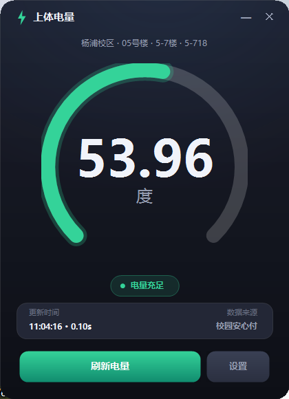

# ShangtiPower · 上体电量

[简体中文](README.md) | English

A tiny open-source Windows desktop tool that shows **Shanghai University of Sport** students
their dormitory's remaining electricity balance.

Launch it and it immediately queries the balance in a small native window. Click ✕ and it exits
completely — no tray icon, no background process. The dorm location is selected once during
first-run setup and remembered afterwards. Optional auto-start at login.

> Unofficial project, not affiliated with the university. It only reads the public,
> login-free balance query that the campus system exposes. No account or password required.



## Features

- **Instant**: double-click, see the remaining kWh in about a second
- **Tiny**: a single 86 KB exe, ~35 MB RAM, exits fully on close
- **Zero runtime**: built on the .NET Framework 4.8 that ships with Windows 10/11
- **First-run wizard**: campus → building → floor → room, stored locally forever
- **Auto-start**: optional, opens the balance window right after login
- **Dark UI**: arc gauge, status colors, custom-drawn controls (no UI framework)
- **No telemetry**: one HTTP request per query, nothing else

## Install

1. Download `ShangtiPowerSetup.exe` from Releases
2. Run it: agree to the license (MIT + disclaimer), pick a folder, choose desktop shortcut /
   auto-start, install
3. First launch: pick your campus → building → floor → room
4. Done — every launch shows your balance; click ✕ to quit

Portable mode: run `ShangtiPower.exe` directly, no installation.

Uninstall: Windows Settings → Apps → 上体电量 → Uninstall, or `ShangtiPower.exe --uninstall`.

> The UI is currently in Chinese (the target users are Chinese students). PRs for i18n are welcome.

## How it works

The campus payment platform exposes a login-free room balance endpoint that only needs
area / building / floor / room IDs. The app stores those four IDs locally and posts one form
request on launch, then renders the result.

- No credentials, no login, no scraping of personal data
- Please only query your own dormitory

## Build

Requirements: Windows + .NET Framework 4.8 (preinstalled on Windows 10/11).

```powershell
powershell -ExecutionPolicy Bypass -File .\build\build.ps1
# dist\ShangtiPower.exe       main app
# dist\ShangtiPowerSetup.exe  installer (embeds the app)
```

## Code signing

See [docs/CODE_SIGNING.md](docs/CODE_SIGNING.md) and [docs/SIGNPATH.md](docs/SIGNPATH.md).
Unsigned builds trigger the Windows SmartScreen warning on first run; the free
SignPath Foundation path removes it for open-source projects.

## Project layout

```
src/          C# sources (WinForms, custom-drawn UI)
installer/    installer wizard + license text
build/        build.ps1 / sign.ps1 / screenshot helper
cloud/        optional Tencent SCF function (scheduled WeChat push)
docs/         code signing, release process, SignPath application
assets/       icon, screenshots, donation QR
```

## Privacy

No telemetry, no analytics, no crash reporting. Locally stored: dorm IDs, low-battery
threshold, auto-start flag. See [SECURITY.md](SECURITY.md).

## License

[MIT](LICENSE)

## Support the project

If this saved you a trip to the recharge machine, feel free to buy the author a coffee ☕
(see the donation QR in the Chinese README).
