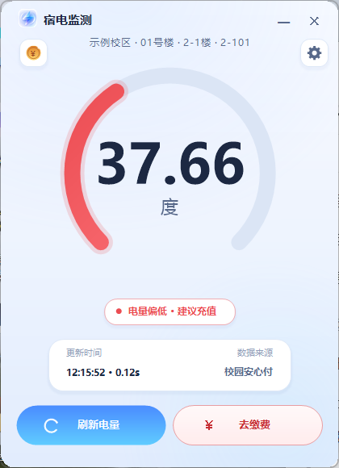
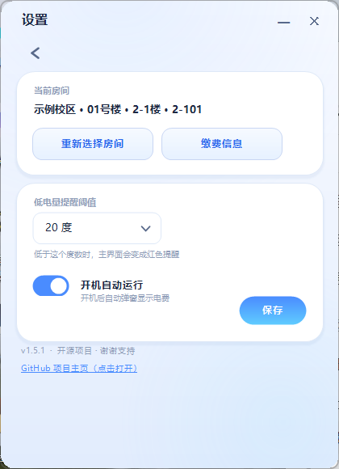
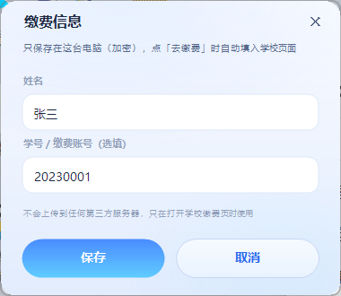
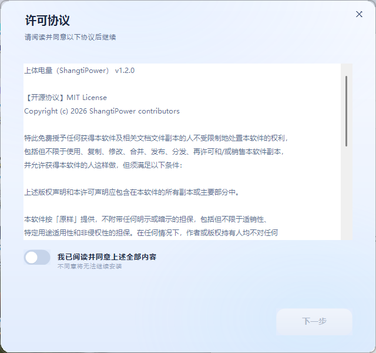

# 宿电监测 · SudianMonitor

[](https://github.com/cyy-12322/shangti-power/releases/latest)
[](https://github.com/cyy-12322/shangti-power/releases)
[](LICENSE)
[](#)

**上体宿舍还剩多少电，看一眼就知道。**

一个 Windows 桌面小工具：开机自动查一次电费，弹个小窗口显示剩余度数；
电量低了提醒你充值，点一下还能直接去官方页面缴费。

> 免登录 · 免安装运行时 · 单文件约 270 KB · 开源免费

[⬇️ 下载最新版](https://github.com/cyy-12322/shangti-power/releases/latest) &nbsp;|&nbsp; [📖 安装使用](#安装与使用) &nbsp;|&nbsp; [English](README.en.md)



> 截图使用虚构的示例房间数据

**如果这个工具帮你少跑了一趟充值机，点个 ⭐ Star 支持一下** —— 让更多上体同学看到它。

---

## 它能做什么

| | |
| --- | --- |
| ⚡ **打开就知道** | 双击图标，1 秒内显示宿舍剩余电量，不用登录、不用打开公众号 |
| 🔔 **低电量提醒** | 电量低于设定值时，界面变红 + 提示「建议充值」 |
| 💳 **一键去缴费** | 记住姓名/学号后，点「去缴费」自动带入房间和姓名，直接进官方缴费页 |
| 🚀 **开机自启** | 开机自动查一次并弹窗，适合每天出门前看一眼 |
| 🪶 **极轻量** | 单个 exe 约 270 KB、内存约 35 MB，关掉即完全退出（无托盘、无后台） |
| 🔒 **隐私友好** | 只调用学校公开的余额接口；个人信息只加密存在本机，不上传 |

## 界面预览

| 电量充足 | 电量偏低 |
| --- | --- |
|  |  |

| 设置 | 缴费信息 |
| --- | --- |
|  |  |

---

## 安装与使用

### 方式一：安装包（推荐）

1. 从 [Releases](https://github.com/cyy-12322/shangti-power/releases/latest) 下载 **`SudianMonitor-Setup.exe`**
   （或带安装说明的 `SudianMonitor-<版本>.zip` 压缩包）
2. 双击运行安装包：
   - 阅读并同意 **许可协议**（MIT + 免责声明）
   - 选择 **安装位置**（默认当前用户目录，可改到 D 盘等任意目录，无需管理员）
   - 勾选是否 **创建桌面快捷方式**、是否 **安装完成后删除安装包**
   - 点「开始安装」
3. 首次启动会弹出设置向导：依次选 **校区 → 楼栋 → 楼层 → 房间**，点「保存并开始」
4. 之后每次开机/双击都会显示剩余电量；点 ✕ 退出



> 安装包旁边附带了 `安装说明.txt`，遇到 SmartScreen 提示/安装失败直接看它。

### 方式二：绿色免安装

直接双击 `宿电监测.exe` 也能用（不会复制到别处，配置写在程序旁边或 `%APPDATA%`）。

### 卸载

设置 → 应用 → 找到「宿电监测」→ 卸载；
或运行安装目录里的 `宿电监测.exe --uninstall`。会删除程序、快捷方式、开机自启与本地配置。

想改设置：点界面右上角 ⚙ 图标，可以换房间、调低电量提醒阈值、开关开机自启。

> ⚠️ 若 SmartScreen 提示「已保护你的电脑」：这是未签名程序的常规提示，点「更多信息 → 仍要运行」即可；
> 或双击安装包旁边的 `Install-Unblocked.cmd` 一键解除。

---

## 缴费说明（重要）

- 点「去缴费」会用默认浏览器打开学校官方「校园安心付」页面，房间和姓名已自动带入
- **线上充值到账有延迟**：通常几分钟，**最长约 3 小时到账都属正常，请勿重复支付**
- 超过 3 小时未到账：先在官方页面看「历史记录」，再联系学校后勤/信息中心（提供时间、金额、房间号）
- 本软件只负责打开官方页面，**不参与支付、不碰钱**

## 它是怎么查到电量的

上海体育大学公众号底部菜单的「校园安心付」电费系统（`axinfu.sus.edu.cn:8082`）有一个**免登录**的房间电量查询接口：
只要 **区域 / 楼栋 / 楼层 / 房间** 四个编号就能查到剩余电量，不需要姓名学号。

本程序做的事就是：把你的四个编号存到本地配置，启动时发一次请求，把结果画出来。

- 没有账号、没有密码、没有登录态
- 不抓包、不逆向客户端，只调用页面上本来就用的接口
- 请不要用它批量查询他人宿舍

## 技术栈

- **C# / WinForms / .NET Framework 4.8**（Windows 10 / 11 自带，无需安装）
- 全部自绘 UI（无第三方界面库）
- 单文件编译产物约 270 KB
- 页面切换动画、圆角窗口、DPAPI 加密存储，全部手写

### 自行编译

需要 Windows + .NET Framework（系统自带）：

```powershell
powershell -ExecutionPolicy Bypass -File .\build\build.ps1
# 输出： dist\宿电监测.exe
```

### 代码签名（让 Windows 识别发布者）

**本机自签名（开发/自用）**

```powershell
.\build\build.ps1 -Sign
```

会创建（或复用）一张自签名代码签名证书，导入「当前用户」的受信任根与受信任发布者，
然后按「签主程序 → 内嵌进安装包 → 签安装包」的顺序签名。仅对本机有效。

移除自签名信任：`.\build\sign.ps1 -RemoveSelfSign`

**正式签名（分发用，需要 CA 证书）**

| 方式 | 费用 | 说明 |
| --- | --- | --- |
| Certum Open Source Code Signing | 免费 | 针对开源项目，需公开仓库 + 申请审核 |
| SignPath Foundation | 免费 | 开源项目，GitHub CI 集成签名 |
| Azure Trusted Signing | 约 $9.99/月 | 需 Microsoft 账号与身份/组织验证 |
| 国内 CA（沃通、天威诚信等） | 约 ¥1000–3000/年 | 个人 OV 代码签名证书 |

拿到 `.pfx` 后一条命令重签：

```powershell
.\build\build.ps1 -Sign -PfxPath "D:\cert\my.pfx" -PfxPassword "密码"
```

校验：`Get-AuthenticodeSignature .\dist\宿电监测安装包.exe`

> EV 证书可立即消除 SmartScreen 提示；普通 OV 证书首次分发仍可能有少量提示，随下载量积累而消失。

### 目录结构

```
src\                  C# 源码
  Program.cs          入口 / 开机自启 / 单实例 / DPAPI 加密
  Config.cs           配置读写（含加密的缴费信息）
  Api.cs              学校接口客户端（级联 + 查电量）
  Theme.cs            配色、圆角、按钮、圆弧表等自绘组件
  MainForm.cs         主界面 / 设置页 / 页面切换动画
  SetupForm.cs        首次设置向导
  PayInfoForm.cs      缴费信息（姓名/学号）
  DonateForm.cs       赞赏窗口
installer\            安装包源码（许可协议/安装位置/选项/释放文件）
build\build.ps1       一键编译（主程序 + 安装包）
assets\               图标、截图、赞赏码
docs\                 发布文案、签名指南
.github\              CI（推送 .release-version 变动时自动构建 + 发布）
CHANGELOG.md          更新日志
SECURITY.md           安全与隐私说明
README.en.md          English README
```

## 命令行参数（给折腾党）

```powershell
宿电监测.exe --selftest          # 不显示界面，查一次并把结果写日志
宿电监测.exe --dump-levels       # 打印学校接口的层级定义
宿电监测.exe --install-autostart # 写入开机自启
宿电监测.exe --remove-autostart  # 取消开机自启
宿电监测.exe --reset             # 删除已保存的宿舍配置（重新走向导）
宿电监测.exe --uninstall         # 卸载（删除程序、快捷方式、自启、配置）
```

## 常见问题

**Q：显示「连不上学校服务器」？**
学校接口偶尔会维护；确认能上网后点「刷新电量」重试。

**Q：换了宿舍怎么办？**
设置 → 重新选择房间。

**Q：接口改版/查不到了？**
学校系统升级可能导致编号变化。可以运行 `--dump-levels` 查看，或提 Issue。这类接口随时可能变，作者无法保证长期可用。

**Q：为什么这么小？**
没有用 Electron，直接调 Windows 自带的 .NET Framework 自绘界面。

**Q：Windows 提示「已保护你的电脑 / 无法识别的应用」？**
这是 SmartScreen 对「未签名」程序的一次性拦截，不是病毒。三种解法任选：
1. 点提示框里的「更多信息」→「仍要运行」
2. 右键 exe → 属性 → 勾选最下面的「解除锁定」→ 确定
3. 双击 `Install-Unblocked.cmd` 一键解除

**Q：安装时提示需要管理员权限 / 安装失败？**
- 不要装到 `C:\Program Files`、`C:\Windows` 或磁盘根目录（需要管理员）
- 默认装到 `%LOCALAPPDATA%\Programs\SudianMonitor`（当前用户目录，无需管理员）
- 选了不可写的目录时会自动改到默认目录并在完成页提示
- 日志：`%TEMP%\ShangtiPowerSetup\install.log`

**Q：配置存在哪？换电脑怎么迁移？**
默认存在 `%APPDATA%\SudianMonitor\config.json`（缴费信息用 Windows DPAPI 加密，换电脑需重新填）。
迁移时把 `config.json` 拷过去即可。

**Q：开机自启在哪关？**
程序内「设置」→ 开机自动运行；或运行 `宿电监测.exe --remove-autostart`。

## 相关文档

- [发布文案（可直接复制使用）](docs/发布文案.md)
- [代码签名指南](docs/CODE_SIGNING.md)：自签名 / SignPath / CA 证书三种方案
- [发布流程](docs/RELEASE.md)：改版本号 → 推送 → CI 自动发布
- [更新日志](CHANGELOG.md)

## 开源协议

[MIT](LICENSE) —— 随便用、随便改、随便分发，保留版权声明即可。

## 赞赏

如果它帮你少充了一次冤枉电，欢迎请作者喝杯奶茶 ☕


> 也欢迎直接 Star ⭐ 或提 Issue —— 对这个项目来说，被用起来比打赏更重要。

## 免责声明

本项目为个人学习作品，**非学校官方工具**。数据来自学校公开查询页面，作者不对数据准确性与可用性负责；
请仅查询本人宿舍，勿用于批量采集或任何商业用途。
