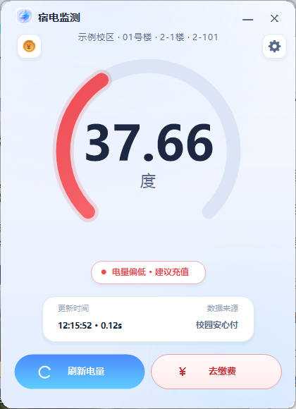
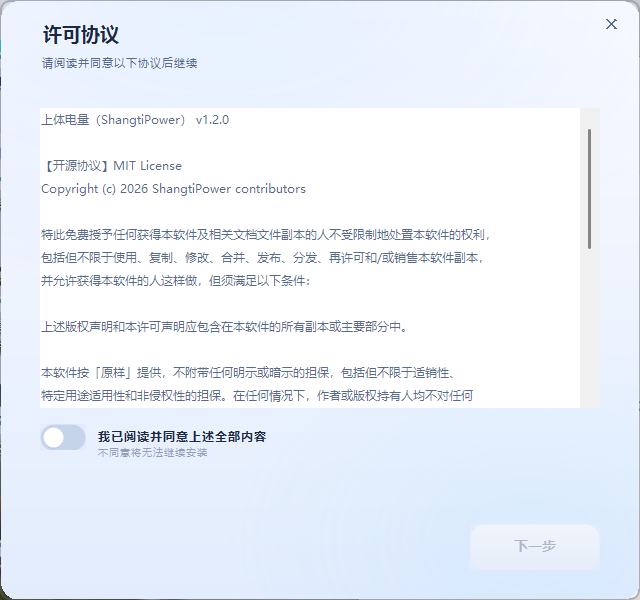

# 宿电监测 · SudianMonitor

简体中文 | [English](README.en.md)

一个**查上海体育大学宿舍剩余电量**的 Windows 桌面小工具。

启动即自动查询，弹一个小窗口告诉你「还剩多少度」；点右上角 ✕ 直接退出，**不驻留后台、不占内存**。
首次运行选一次宿舍位置，之后自动记住；可设为开机自动运行，开机就把电量摆在你面前。

> 非官方项目，与学校无关。只读取你自己宿舍的公开查询结果，不需要账号密码。


> 截图使用虚构的示例房间数据。

---

## 功能

- ⚡ **开箱即用**：双击 exe，1 秒内显示剩余电量
- 🪶 **极轻量**：单个 exe 约 **260 KB**，内存约 35 MB，关闭即完全退出（无托盘、无后台进程）
- 🧭 **首次向导**：校区 → 楼栋 → 楼层 → 房间 四级联动选择，选一次永久记住
- 🚀 **开机自启**：默认开启，开机自动查一次并弹窗（可在设置里关掉）
- 🎨 **清新浅色界面**：蓝青渐变圆弧电量表 + 状态提示（充足 / 注意 / 偏低），低电量自动变红
- 💳 **一键缴费**：可记住姓名/学号（Windows DPAPI 加密存本机）；点「去缴费」打开学校官方缴费页并自动复制姓名，按 Ctrl+V 粘贴即可，避免自动提交造成的订单异常；本软件不参与支付
- ✨ **页面切换动画**：主页 ↔ 设置页滑动过渡（约 210ms，跟手不拖沓）
- 🔌 **零依赖**：只用 Windows 自带的 .NET Framework 4.8，**不需要安装任何运行时，也不需要装 Python/Node**
- 🔒 **除了一次查询不联网**：不注册、不上传、不统计

## 安装与使用

### 方式一：安装包（推荐）

1. 从 [Releases](https://github.com/cyy-12322/shangti-power/releases) 下载 **`SudianMonitor-Setup.exe`**（或含安装说明的 `SudianMonitor-<版本>.zip` 压缩包）
2. 双击运行安装包：
   - 阅读并同意 **许可协议**（MIT + 免责声明）
   - 选择 **安装位置**（默认当前用户目录，可改到 D 盘等任意目录，无需管理员）
   - 勾选是否 **创建桌面快捷方式**、是否 **安装完成后删除安装包**
   - 点「开始安装」
3. 首次启动会弹出设置向导：依次选 **校区 → 楼栋 → 楼层 → 房间**，点「保存并开始」
4. 之后每次开机/双击都会显示剩余电量；点 ✕ 退出



> 安装包旁边附带了 `安装说明.txt`，遇到 SmartScreen 提示/安装失败直接看它。

### 方式二：绿色免安装

直接双击 `宿电监测.exe` 也能用（不会复制到别处，配置写在程序旁边或 %APPDATA%）。

### 卸载

控制面板 → 应用 → 找到「宿电监测」→ 卸载；
或运行安装目录里的 `宿电监测.exe --uninstall`。会删除程序、快捷方式、开机自启与本地配置。

想改设置：点界面右上角 ⚙ 图标，可以换房间、调低电量提醒阈值、开关开机自启。

> 如果杀毒软件报毒：这是未签名的个人开源程序（未做代码签名），可自行用源码编译对比，或加入信任。

## 它是怎么查到电量的

上海体育大学公众号底部菜单的「校园安心付」电费系统（`axinfu.sus.edu.cn:8082`）有一个**免登录**的房间电量查询接口：
只要 **区域 / 楼栋 / 楼层 / 房间** 四个编号就能查到剩余电量，不需要姓名学号。

本程序做的事就是：把你的四个编号存到 `%APPDATA%\ShangtiPower\config.json`，启动时发一次请求，把结果画出来。

- 没有账号、没有密码、没有登录态
- 不抓包、不逆向客户端，只调用页面上本来就用的接口
- 请不要用它批量查询他人宿舍

## 技术栈

- **C# / WinForms / .NET Framework 4.8**（Windows 10 / 11 自带，无需安装）
- 全部自绘 UI（无第三方界面库）
- 单文件编译产物 ~75 KB

### 自行编译

需要 Windows + .NET Framework（系统自带）：

```powershell
powershell -ExecutionPolicy Bypass -File .\build\build.ps1
# 输出： dist\ShangtiPower.exe
```

### 代码签名（让 Windows 识别发布者）

**本机自签名（开发/自用）**

```powershell
.\build\build.ps1 -Sign
```

会创建（或复用）一张自签名代码签名证书，导入「当前用户」的受信任根与受信任发布者，
然后按「签主程序 → 内嵌进安装包 → 签安装包」的顺序签名。仅对本机有效。

移除自签名信任：`.\build\sign.ps1 -RemoveSelfSign`

**正式签名（分发用，需要 CA 证书）**

| 方式 | 费用 | 说明 |
| --- | --- | --- |
| Certum Open Source Code Signing | 免费 | 针对开源项目，需公开仓库 + 申请审核 |
| SignPath Foundation | 免费 | 开源项目，GitHub CI 集成签名 |
| Azure Trusted Signing | 约 $9.99/月 | 需 Microsoft 账号与身份/组织验证 |
| 国内 CA（沃通、天威诚信等） | 约 ¥1000–3000/年 | 个人 OV 代码签名证书 |

拿到 `.pfx` 后一条命令重签：

```powershell
.\build\build.ps1 -Sign -PfxPath "D:\cert\my.pfx" -PfxPassword "密码"
```

校验：`Get-AuthenticodeSignature .\dist\ShangtiPowerSetup.exe`

> EV 证书可立即消除 SmartScreen 提示；普通 OV 证书首次分发仍可能有少量提示，随下载量积累而消失。
### 目录结构

```
src\                  C# 源码
  Program.cs          入口 / 开机自启 / 命令行自检
  Config.cs           配置读写
  Api.cs              学校接口客户端（级联 + 查电量）
  Theme.cs            配色、圆角、按钮、圆弧表等自绘组件
  MainForm.cs         主界面
  SetupForm.cs        首次设置向导
  SettingsForm.cs     设置
installer\            安装包源码（许可协议/安装位置/选项/释放文件）
build\build.ps1       一键编译（主程序 + 安装包）
assets\               图标、截图、赞赏码
cloud\                附带：腾讯云函数版（定时推送到微信，可选）
docs\                 代码签名、发布流程、SignPath 申请指南
.github\              CI（自动构建/发布）与 Issue 模板
CHANGELOG.md          更新日志
SECURITY.md           安全与隐私说明
README.en.md          English README
```

## 命令行参数（给折腾党）

```powershell
ShangtiPower.exe --selftest          # 不显示界面，查一次并把结果写到 %APPDATA%\ShangtiPower\cli.txt
ShangtiPower.exe --dump-levels       # 打印学校接口的层级定义
ShangtiPower.exe --install-autostart # 写入开机自启
ShangtiPower.exe --remove-autostart  # 取消开机自启
ShangtiPower.exe --reset             # 删除已保存的宿舍配置（重新走向导）
ShangtiPower.exe --uninstall         # 卸载（删除程序、快捷方式、自启、配置）
```

## 常见问题

**Q：显示「连不上学校服务器」？**
学校接口偶尔会维护；确认能上网后点「刷新电量」重试。

**Q：换了宿舍怎么办？**
设置 → 重新选择房间。

**Q：接口改版/查不到了？**
学校系统升级可能导致编号变化。可以运行 `--dump-levels` 查看，或提 Issue。这类接口随时可能变，作者无法保证长期可用。

**Q：为什么这么小？**
没有用 Electron，直接调 Windows 自带的 .NET Framework 自绘界面。

**Q：Windows 提示「已保护你的电脑 / 无法识别的应用」，双重点击装不了？**
最省事：双击安装包旁边的 **`Install-Unblocked.cmd`** —— 它会先移除「网络来源」标记，再启动安装程序，不会再弹。
这是 SmartScreen 对「未签名 + 带网络来源标记」程序的一次性拦截，不是病毒。三种解法任选：
1. 右键 exe → 属性 → 最下方勾选「解除锁定」→ 确定
2. 点提示框里的「更多信息」→ 再点「仍要运行」
3. PowerShell：`Get-ChildItem "文件夹\*.exe" | Unblock-File`
本机编译出来的 exe 不带网络标记，不会弹。彻底免提示需购买代码签名证书（付费），个人开源项目一般用上面三招。

**Q：安装时提示需要管理员权限 / 安装失败？**
- 不要装到 `C:\Program Files`、`C:\Windows` 或磁盘根目录（需要管理员）
- 安装包默认装到 `%LOCALAPPDATA%\Programs\ShangtiPower`（当前用户目录，不需要管理员）
- 选了不可写的目录时，安装包会**自动改到默认目录**并在完成页提示，不会安装失败
- 若仍失败：完全退出 DeepSeek Harness 或重启电脑后再装（当前会话可能限制写用户目录）
- 日志：`%TEMP%\ShangtiPowerSetup\install.log`
**Q：配置存在哪？换电脑怎么迁移？**
默认存在 `%APPDATA%\ShangtiPower\config.json`。
如果该目录不可写（某些安全软件会拦截未签名程序），程序会自动改存到 **exe 同级的 `config\` 目录**（便携模式）；
两种位置都会自动识别，迁移时把 `config.json` 拷过去即可。
**Q：开机自启在哪关？**
程序内「设置」→ 开机自动运行；或运行 `ShangtiPower.exe --remove-autostart`。

## 相关文档

- [代码签名指南](docs/CODE_SIGNING.md)：自签名 / SignPath / CA 证书三种方案
- [SignPath 免费签名申请](docs/SIGNPATH.md)：申请表文案 + 审批后接入步骤
- [发布流程](docs/RELEASE.md)：改版本号 → 打 tag → CI 自动发布
- [更新日志](CHANGELOG.md)
- [云端定时推送（腾讯云函数）](cloud/tencent-scf/README-部署.md)

## 开源协议

[MIT](LICENSE) —— 随便用、随便改、随便分发，保留版权声明即可。

## 赞赏

如果它帮你少充了一次冤枉电，欢迎请作者喝杯奶茶 ☕


（把微信/支付宝收款码保存为 `assets/donate.jpg` 或 `assets/donate.png` 即可替换）

> 也欢迎直接 Star ⭐ 或提 Issue —— 对这个项目来说，被用起来比打赏更重要。

## 免责声明

本项目为个人学习作品，**非学校官方工具**。数据来自学校公开查询页面，作者不对数据准确性与可用性负责；
请仅查询本人宿舍，勿用于批量采集或任何商业用途。
